<p align="center">
  
</p>

<p align="center">
  
</p>

<p align="center">
  <a href="https://www.linkedin.com/in/sujith-kumar26"></a>
  <a href="mailto:SUJITHKU002@e.ntu.edu.sg"></a>
  
  
</p>

---

### 🤖 `$ cat about.txt`

```cpp
struct Engineer {
    std::string name_     = "Sujith Kumar";
    std::string base_     = "Singapore 🇸🇬";
    std::string study_    = "B.Eng Computer Engineering @ NTU (2024 – 2028)";
    std::vector<std::string> loves_ = {
        "firmware that talks to real hardware",
        "control loops that actually settle",
        "test rigs that find the fault before the robot does",
    };
    std::string now_      = "taking an autonomy stack from STM32 → CAN → ROS 2";
};
```

<p align="center">
  
</p>

### 🛠️ `$ ls ~/projects`

<table>
<tr>
<td width="50%" valign="top">

#### 🏆 [Autonomous Robot — NTU MDP](https://github.com/suujithhhh/SC2079-MDP-Group7)
**1st of 32 teams** · Team Lead · STM32 firmware lead

- STM32F407 + FreeRTOS firmware: command queue → motion state machine
- Cascaded wheel PID + IMU heading hold, **within ~1°** on turns
- UART protocol with ACK/ERR + priority STOP
- Python state-lattice planner that powered the #1 run

`C` `FreeRTOS` `I2C` `UART` `PWM` `Python`

</td>
<td width="50%" valign="top">

#### ⚙️ [MDP Robot Autonomy Stack](https://github.com/suujithhhh/mdp-robot-autonomy-stack)
**C++17 · simulated CAN · ROS 2** (in progress)

- Hardware-free STM32 simulator speaking the real protocol
- CAN 2.0A from scratch: bit stuffing, CRC-15, arbitration, bus-off
- **100/100** missions completed with ~5% frames corrupted
- Planner ported to C++: **33× faster**, 213 GoogleTest cases

`C++17` `CMake` `GTest` `ASan/UBSan` `ROS 2`

</td>
</tr>
</table>

### 🧰 `$ apt list --installed`

<p align="center">
  
</p>

<p align="center">
  
  
  
  
  
</p>

### 📡 `$ ./telemetry --github`

<p align="center">
  
  
</p>

<p align="center">
  <picture>
    <source media="(prefers-color-scheme: dark)" srcset="https://raw.githubusercontent.com/suujithhhh/suujithhhh/output/snake-dark.svg"/>
    
  </picture>
</p>

<p align="center">
  
</p>
